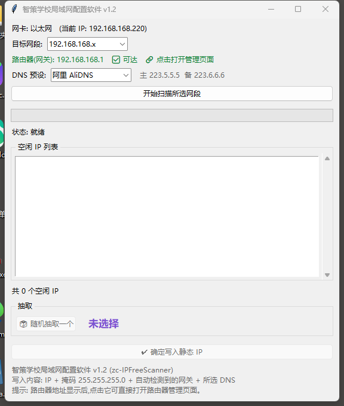
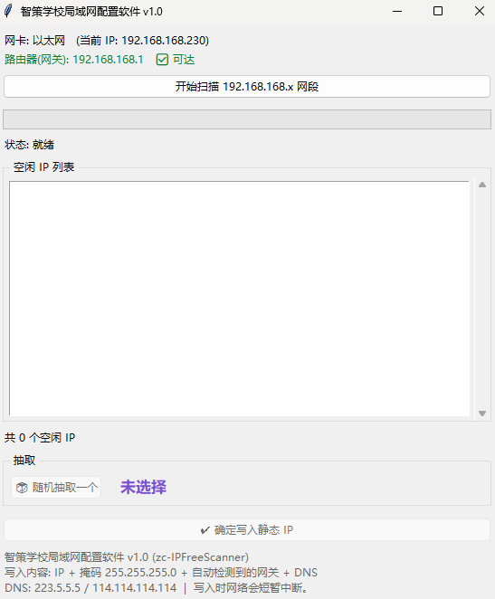

# 智策学校局域网配置软件 (zc-IPFreeScanner)

   

一款面向学校机房 / 办公局域网的 **IP 空闲扫描与静态 IP 一键配置工具**。自动扫描局域网空闲 IP,随机抽取一个,确认后自动写入 Windows 静态 IP,无需手动打开网络设置一层层点。

> 适用于:机房批量装机、给电脑固定 IP、快速腾挪设备网段等场景。

---

## ✨ 功能特性

| 功能 | 说明 |
|---|---|
| 🔍 **空闲 IP 扫描** | 64 线程并发 Ping + 系统 ARP 表**双重检测**,误判率低,全段扫描仅约 3~6 秒 |
| 🌐 **网段切换** | 支持 `192.168.168.x` / `192.168.200.x` 一键切换,扫描、网关全部自动跟随 |
| 📡 **路由器自动识别** | 启动即自动检测当前所连路由器(默认网关)地址,并 ping 验证可达性 |
| 🔗 **直达路由器管理页** | 点击路由器地址行,自动调用浏览器打开路由器登录管理页面 |
| 🎲 **随机抽取 IP** | 从空闲列表随机抽取一个并高亮,也支持手动点击选择 |
| ✔️ **一键写入静态 IP** | 确认后自动执行 `netsh` 写入 IP / 掩码 / 网关 / DNS,写入前二次确认 |
| 🧭 **DNS 预设切换** | 内置 7 家国内主流 DNS(阿里 / 腾讯 / 114 / 百度 / 360 / 火山 / CNNIC),下拉即换 |
| 🛡 **安全防护** | 自动排除网关地址、广播地址和本机当前 IP,避免地址冲突 |
| 📦 **单文件绿色版** | 单个 exe,无需安装,自带应用图标与版本信息 |

## 📷 软件截图

### v1.2 主界面



*顶部:网卡识别、目标网段切换、路由器(网关)检测(可点击直达管理页)、DNS 预设选择。*

### v1.0 界面(历史版本)



## 🚀 下载与使用

### 方式一:下载绿色版 exe(推荐)

1. 前往 [**Releases**](https://github.com/openclawzhangchong/zc-IPFreeScanner/releases) 页面
2. 下载 `zc-IPFreeScanner.exe`(单文件,约 11 MB,免安装)
3. **双击运行** —— 程序会自动请求管理员权限(UAC 弹窗选「是」)

> ⚠️ 写入静态 IP 必须管理员权限。若提权被拒绝,仍可正常扫描,但「确定写入」按钮会提示权限不足。

### 方式二:从源码运行

```bash
# 克隆仓库
git clone https://github.com/openclawzhangchong/zc-IPFreeScanner.git
cd zc-IPFreeScanner

# 运行(仅需 Python 3.8+,无任何第三方依赖)
python ip_free_scanner.py

# 自行打包 exe(需要 pyinstaller)
pip install pyinstaller
pyinstaller --onefile --windowed --uac-admin --name zc-IPFreeScanner ^
            --icon app.ico --version-file version_info.txt ip_free_scanner.py
```

## 📋 使用流程

```
启动(自动识别网卡 + 路由器)
        │
        ▼
选择目标网段(168.x / 200.x)──▶ 点击「开始扫描」
        │
        ▼
扫描完成,空闲 IP 列表展示(约 3~6 秒)
        │
        ▼
点击「🎲 随机抽取一个」(或手动点击列表选择)
        │
        ▼
选择 DNS 预设(默认阿里 DNS)
        │
        ▼
点击「✔ 确定写入静态 IP」──▶ 二次确认弹窗(显示完整写入内容)
        │
        ▼
netsh 自动写入,弹窗提示写入结果
```

## ⚙️ 工作原理

1. **空闲检测**:对网段 1~254 并发发送 1 个 ICMP Ping(超时 600ms),再读取系统 ARP 表交叉比对——**Ping 无响应 且 不在 ARP 表** 才判定为空闲,可避开「防火墙禁 Ping 但实际在线」的设备。
2. **路由器识别**:通过 `Get-NetRoute` 读取默认路由(0.0.0.0/0)的下一跳地址,即当前所连路由器的 LAN 地址;并 ping 一次验证可达性。
3. **网卡选择**:自动选择默认路由所在的活动网卡,无需手动指定。
4. **静态写入**:依次执行:
   ```bat
   netsh interface ip set address name="网卡名" static IP 掩码 网关
   netsh interface ip set dns   name="网卡名" static 主DNS primary
   netsh interface ip add  dns   name="网卡名" 备DNS index=2
   ```

## 🌐 内置 DNS 预设

| 名称 | 主 DNS | 备 DNS |
|---|---|---|
| 阿里 AliDNS(默认) | 223.5.5.5 | 223.6.6.6 |
| 腾讯 DNSPod | 119.29.29.29 | 182.254.116.116 |
| 114DNS | 114.114.114.114 | 114.114.115.115 |
| 百度 DNS | 180.76.76.76 | — |
| 360 DNS | 101.226.4.6 | 123.125.81.6 |
| 火山引擎 | 180.184.1.1 | 180.184.2.2 |
| CNNIC SDNS | 1.2.4.8 | 210.2.4.8 |

## ⚠️ 注意事项

- 写入静态 IP 过程中网络会**短暂中断几秒**,属正常现象。
- 若网络中存在 DHCP 服务器,静态 IP 绕过了 DHCP 分配,**理论上存在地址被重复分配的风险**;本工具通过 Ping + ARP 双重检测已尽量规避,但建议学校网络做好 IP-MAC 规划或绑定。
- 网段中的 `.1`(网关)与 `.255`(广播)地址自动排除,不会出现在空闲列表中。
- 如需增加其他网段(如 `192.168.100.x`),编辑源码顶部 `SUBNETS` 列表即可,一行一个。

## 📝 版本历史

| 版本 | 日期 | 更新内容 |
|---|---|---|
| **v1.2** | 2026-11-02 | 新增 192.168.200.x 网段切换;扫描/网关全部按所选段参数化 |
| **v1.1** | 2026-11-02 | 路由器地址可点击直达管理页;新增 7 家国内 DNS 预设切换;修复写入后界面卡住的问题 |
| **v1.0** | 2026-11-02 | 首个版本:空闲 IP 扫描(Ping+ARP)、随机抽取、一键写入静态 IP、紫色主题图标 |

## 📄 许可

[MIT License](LICENSE) © 2026 openclawzhangchong
